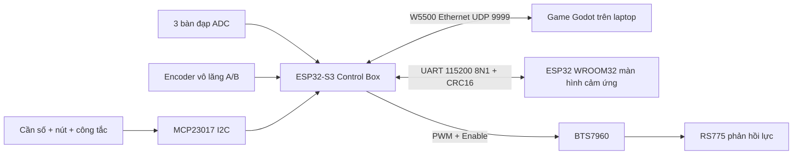

# Bộ firmware SimRacing: S3 Control Box + WROOM32 Touchscreen

**Cập nhật 13/10/2026:** đã sửa watchdog khi W5500/socket chưa khởi tạo và nạp thử S3. Xem [kết quả đo và các điểm phải sửa trên sơ đồ](../docs/SUA_LOI_DAU_NOI_S3.md). Log chẩn đoán hiện xuất qua UART0/CH343 115200; motor vẫn khóa.

Bộ này tích hợp với **game Godot trong `simracing_game_native`** và sơ đồ `mạch esp32-control box.png`. Màn hình dựa trên firmware thử đã chạy của bạn và cấu hình TFT_eSPI đọc trực tiếp trên máy. Bản web trong `simracing_game_3d` là bản cũ có quy ước 6 số tiến/7=lùi khác; không chạy Node server cùng game Godot vì cùng chiếm UDP 9999. Không dùng firmware sample cũ để điều khiển motor.

**Mở hai sketch riêng:**

- `ControlBoxS3/ControlBoxS3.ino`: ESP32-S3 + W5500 + MCP23017 + encoder + BTS7960.
- `TouchscreenWroom/TouchscreenWroom.ino`: ESP32 WROOM32 + TFT ILI9341 + XPT2046.

Mỗi sketch có `Config.h` và `RigProtocol.h` đi kèm. Giữ nguyên cả thư mục khi chép sang máy khác. File thử `manhinhcamung.ino` được giữ nguyên để đối chiếu.

## 1. Ý tưởng vận hành

S3 là nơi duy nhất đọc/chuẩn hóa phần cứng và điều khiển driver. Game là nơi tính tốc độ, vòng tua, số thực tế, xăng, đèn và lực. Màn hình nhận trạng thái thật, không tự chạy số tốc độ giả. Màn hình gửi START, HAZARD, CENTER, ARM, STOP về S3; S3 kiểm tra điều kiện và trả xác nhận.

| Linh kiện/thao tác | Cách xử lý | Tác dụng trong game |
|---|---|---|
| PR1 / PR2 / PR3 | Côn / phanh / ga, ADC 12 bit, lọc IIR, hiệu chỉnh đầu-cuối | Côn / phanh / ga tương ứng |
| Encoder A/B | Đọc đủ 4 cạnh, loại chuyển trạng thái bất hợp lệ | Lái trái/phải; dương = trái theo Godot |
| U1…U5 / U6 | Chỉ một tiếp điểm đóng; không đóng = N | Số 1…5 / R; mã 6 luôn là lùi |
| Hai tiếp điểm số cùng đóng | Chuyển N + báo lỗi + khóa FFB | Không tự đoán một số bất kỳ |
| Ignition GPA6 | Công tắc duy trì, mức đóng = bật điện | Tắt công tắc tắt máy; bật điện rồi START để đề |
| Start GPA7 / START cảm ứng | Nút vật lý giữ mức; cảm ứng tạo xung 250 ms | Đề máy; đạp ga không tự đề khi dùng rig |
| Hazard GPB0 / HAZARD cảm ứng | Nút nhấn nhả, mỗi lần nhấn đổi trạng thái | Bật/tắt đèn cảnh báo |
| Lights GPB1/GPB2 | Công tắc OFF / LOW / HIGH | Đèn tắt / gần / xa thật trên xe |
| Wipers GPB3/GPB4 | Công tắc OFF / SLOW / FAST | Hai cần gạt chuyển động; tắt thì về vị trí nghỉ |
| Horn GPB5 | Nhấn giữ, nhả là tắt | Còi vòng lặp 350 + 440 Hz |
| Xi-nhan GPB6/GPB7 | Công tắc trái / giữa / phải duy trì | Trạng thái theo công tắc; không tự hủy bằng game khi dùng rig |
| Joystick X/Y / nút GPIO21 | Nhìn quanh / nhấn đổi camera một lần | 4 góc camera; không lặp khi giữ nút |

Chống dội 20 ms; đọc đầu vào mỗi 5 ms; UDP 100 Hz; màn hình nhận 20 Hz và vẽ 10 Hz. Gạt mưa là mô hình hình học trong cockpit, chưa mô phỏng nước bị quét khỏi kính. Nhiệt độ nước 90 °C vẫn là giá trị mô phỏng của game, không phải cảm biến nhiệt thật. ABS/TCS chưa được game tính nên không tạo cờ giả.

## 2. Chân S3 theo sơ đồ

| Chức năng | GPIO S3 | Ghi chú |
|---|---:|---|
| Côn PR1 / phanh PR2 / ga PR3 | 1 / 2 / 3 | Hai đầu biến trở 3V3 và GND; con chạy vào ADC |
| Joystick X / Y / nhấn | 4 / 5 / 21 | Nút nhấn kéo xuống GND |
| Encoder A / B | 15 / 16 | Phải là tín hiệu logic tối đa 3,3 V |
| MCP23017 SDA / SCL | 8 / 18 | I2C 100 kHz, địa chỉ 0x20 |
| W5500 MOSI / MISO / SCK | 11 / 13 / 12 | Kế thừa mapping firmware mẫu, cần kiểm tra nhãn module |
| W5500 CS / RESET / INT | 10 / 14 / 9 | INT hiện không dùng, firmware polling |
| BTS7960 RPWM / LPWM | 6 / 7 | PWM 20 kHz, 8 bit |
| BTS7960 R_EN / L_EN | 41 / 42 | Cả hai LOW khi khóa/ngắt lực |
| UART TX / RX màn hình | 39 / 40 | Đã đổi khỏi 43/44 để dành cặp UART0 cho USB–UART |

**Sơ đồ đầu W5500 chỉ ghi GPIO, không ghi MOSI/MISO/SCK/CS.** Bảng trên là mapping từ firmware mẫu trong dự án, chưa xác minh bằng đo dây. Nếu nhãn thực tế khác, sửa `ETH_*` trong Config.h cho đúng. Tương tự U9 chưa ghi tên từng chân ở ảnh; xác minh RPWM, LPWM, R_EN, L_EN trên driver thay vì chỉ đếm chân theo hình.

### MCP23017 và giắc control box

VDD pin 9 = 3V3, VSS pin 10 = GND, A0/A1/A2 xuống GND. SCL pin 12 -> GPIO18; SDA pin 13 -> GPIO8. **RESET# pin 18 phải kéo lên 3V3 bằng khoảng 10 kΩ**; ảnh hiện đánh dấu không nối. Thêm pull-up SDA/SCL khoảng 4,7 kΩ lên 3V3 nếu module chưa có, tụ 100 nF sát VDD/VSS. GPIO input dùng pull-up, công tắc đóng xuống GND; không đưa 5/12 V vào GPA/GPB.

| MCP23017 | Thiết bị | Bit trong buttons_mask |
|---|---|---:|
| GPA0…GPA5 | U1…U6: 1,2,3,4,5,R | Không thuộc buttons_mask |
| GPA6 | Ignition | 0 |
| GPA7 | Start | 1 |
| GPB0 | Hazard nhấn nhả | 2, đã chốt trạng thái |
| GPB1 / GPB2 | Đèn gần / xa | 3 / 4 |
| GPB3 / GPB4 | Gạt chậm / nhanh | 5 / 6 |
| GPB5 | Còi | 7 |
| GPB6 / GPB7 | Xi-nhan trái / phải | 8 / 9 |

Hai vị trí cùng đóng trên công tắc đèn/gạt: ưu tiên vị trí 2. Công tắc xi-nhan có cả hai bit thì cả hai đèn nháy. Riêng cần số, hai tiếp điểm là lỗi.

## 3. UART và màn hình đang dùng

Đã đọc `Documents/Arduino/libraries/TFT_eSPI/User_Setup.h`: driver `ILI9341_2_DRIVER`; TFT MISO12, MOSI13, SCK14, CS15, DC2, RST=-1, BL21; SPI 55 MHz. Cảm ứng từ sketch gốc: MOSI32, MISO39, CLK25, CS33, IRQ36, rotation=1, 320x240 ngang. Vì không có sơ đồ nhà sản xuất, đây là cấu hình suy ra từ phần mềm đã hoạt động, chưa phải xác nhận mã board in trên PCB.

Firmware mới vẫn dùng TFT_eSPI và XPT2046 nhưng vẽ trực tiếp qua sprite, **không cần LVGL**. Tránh lỗi cấu hình LVGL giữa các máy. TFT giữ cấu hình đang chạy; cảm ứng dùng SPI peripheral còn lại (HSPI nếu TFT dùng VSPI, hoặc ngược lại), không ghi đè cấu hình chân TFT như khi cả hai cùng VSPI.

| Dây | Đầu Control Box | Đầu WROOM32 đề xuất |
|---|---|---|
| Dữ liệu tới màn hình | TX GPIO39 | RX GPIO27 |
| Dữ liệu về hộp | RX GPIO40 | TX GPIO22 |
| Mass | GND | GND |
| Nguồn | 5 V đã ổn áp | Chân 5V/VIN phù hợp board màn hình |

GPIO27/22 là cặp UART **đề xuất**, cần xác minh chân được đưa ra trên board thực tế; không nối theo tên giắc đoán. Đổi `UART_RX/UART_TX` nếu dùng chân khác còn trống. Trên **ESP32-WROOM32 của màn hình**, GPIO36/39 chỉ làm input; không dùng làm TX. Hạn chế này không áp dụng cho GPIO39 của ESP32-S3 Control Box. Không dùng GPIO16/17 mặc định UART2 vì trên nhiều CYD chúng nối LED RGB.

**Firmware hiện dùng GPIO39 (TX) / GPIO40 (RX) cho màn hình**: GPIO17 đã được bạn dùng, còn cặp GPIO43/44 nối chip USB–UART. GPIO39/40 nằm cạnh nhau trên hàng phải của sơ đồ, giữa nhóm GPIO41/42 và GPIO38; chưa thấy được dùng bởi ngoại vi Control Box trong sơ đồ/cấu hình hiện có. Chọn theo nhãn GPIO in trên board, không theo số thứ tự chân của ký hiệu trong ảnh. Cặp này chỉ phù hợp khi mạch thực tế chưa đấu thêm ngoại vi hoặc đầu dò JTAG ngoài vào GPIO39/40. Chuyển TX màn hình của S3 sang GPIO39; nếu RX đã ở GPIO40 thì giữ nguyên. Không để dây màn hình trên 17 hoặc 43/44; đây là thay đổi so với sơ đồ gốc. Cặp 43/44 để dành cho USB–UART, vẫn nạp qua cổng USB–UART như bình thường. Khi nạp bằng cổng này có thể để USB CDC On Boot = Disabled. Không cần sửa/nạp lại màn hình nếu nó đang dùng RX27/TX22. Không cắm dây 5 V vào RX/TX; UART hai bên là 3,3 V. Dây UART ngắn, đi cùng mass; nếu đi xa/gần motor, cân nhắc transceiver RS485 phù hợp thay cho kéo UART trực tiếp.

`config/TFT_eSPI_User_Setup.h` lưu bản cấu hình TFT đã đọc trên máy. Trên máy này không cần thay thư viện. Trên máy khác, sao lưu rồi chép nội dung file đó vào `TFT_eSPI/User_Setup.h`, chọn duy nhất setup ấy trong `User_Setup_Select.h`. Chỉ đặt một file cùng tên cạnh sketch sẽ không cấu hình được phần `.cpp` của thư viện. Nếu màn hình nhiễu, thử hạ SPI_FREQUENCY xuống 40000000. Cảm ứng lệch: chỉnh `TOUCH_*` trong Config.h; khởi đầu dùng đúng các mốc của sketch thử.

## 4. Những việc cần làm ở mạch trước khi cấp lực

- LM2596: đo/chỉnh đúng 5,0 V trước khi nối S3 và màn hình. Đường motor 12 V riêng, dây/mass dòng lớn đi riêng rồi quy về điểm chung với mass tín hiệu. Tránh nối song song hai nguồn 5 V USB và buck khi board không có mạch chọn nguồn.
- Encoder trên ảnh cấp 5 V: đo/xác định kiểu ngõ ra. NPN open-collector thì kéo A/B lên 3V3 khi thiết kế ngõ ra cho phép; nếu push-pull 5 V thì dùng chuyển mức/chia áp phù hợp, không nối thẳng ESP32. Không suy ra điện áp tín hiệu chỉ từ màu dây.
- BTS7960/U9: kiểm tra module có buffer gì và điện áp VCC theo nhà sản xuất. 3V3 cấp logic như ảnh chưa chắc phù hợp mọi module IBT-2; dùng nguồn logic và chuyển mức tương thích nếu yêu cầu 5 V. M+ / M- chỉ tới motor, không tới GPIO.
- Thêm pull-down ngoài khoảng 10 kΩ cho R_EN/L_EN (và PWM nếu cần) để reset/boot không tự kích motor. Có nút ngắt nguồn motor vật lý, cầu chì và nguồn giới hạn dòng phù hợp motor/dây. STOP trên màn hình là phần mềm, không thay ngắt nguồn vật lý.
- GPIO3 là chân strap của S3. Giữ mapping ADC theo ảnh nhưng kiểm tra cold boot ở cả hai đầu hành trình ga; nếu board cụ thể gặp vấn đề strap/JTAG, chuyển ADC ga sang chân ADC còn trống và sửa Config.h.
- Không có đo dòng/nhiệt motor hoặc công tắc hành trình trong sơ đồ. PWM thấp không đảm bảo giới hạn mô-men/nhiệt trong mọi tải. Cơ cấu phải có giới hạn hành trình và không thử lực lớn trước khi xác nhận chiều và dòng.

## 5. Nạp bằng Arduino IDE

Đã biên dịch với **esp32 by Espressif Systems 3.3.11**. Thư viện:

| Sketch | Thư viện ngoài core |
|---|---|
| ControlBoxS3 | Ethernet by Various/Arduino **2.0.2** |
| TouchscreenWroom | TFT_eSPI **2.5.43**, XPT2046_Touchscreen **1.4** |

SPI, Wire, HardwareSerial, LEDC và task watchdog có sẵn trong core. Firmware dùng LEDC API core 3.x, không dùng core 2.x.

1. Arduino IDE -> Boards Manager cài/chọn ESP32 3.3.11. Library Manager cài đúng các thư viện trên; Ethernet 2.0.2 đã được cài vào máy trong lần làm này.
2. Mở `ControlBoxS3/ControlBoxS3.ino`. Board **ESP32S3 Dev Module**, **USB CDC On Boot = Enabled** nếu dùng Serial Monitor qua USB native; **Disabled cũng biên dịch/nạp được** nhưng firmware không mở Serial debug. Flash Size theo chip thực tế, PSRAM Disabled nếu chưa biết loại. Bản đã kiểm tra dùng cấu hình mặc định 4 MB, default partition, không cần PSRAM. Chọn đúng cổng nạp của board và Upload. UART màn hình đã cấu hình sang GPIO39/40; chuyển dây theo mục 3 trước khi vận hành, không để màn hình trên GPIO43/44. Không chọn board WROOM32 cho sketch S3.
3. Mở `TouchscreenWroom/TouchscreenWroom.ino`. Board **ESP32 Dev Module**, flash theo board (CYD thông thường 4 MB), default partition, PSRAM Disabled. Chọn cổng của màn hình rồi Upload.
4. Nạp lần đầu với nguồn motor ngắt. Kiểm tra màn hình, DATA, UART trước. Không cần nạp `.bin` thủ công: Arduino IDE biên dịch và nạp đúng các thành phần.
5. Hai bản `RigProtocol.h` phải giống nhau. Khi đổi cấu trúc UART, cập nhật và nạp **cả hai** board.

## 6. Nối Ethernet và chạy game đã tích hợp

Mặc định S3 **192.168.1.150/24**, laptop **192.168.1.100/24**, UDP nguồn/đích **9999**. Cấu hình laptop trên adapter Ethernet cắm với W5500; nối trực tiếp không cần gateway/DNS. Nếu dùng router, hai IP phải cùng subnet, không trùng thiết bị khác. Đổi `localIP` và `pcIP` trong sketch S3 nếu mạng của bạn khác. Firmware dùng IP tĩnh, không tự tìm laptop/DHCP. MAC phải duy nhất nếu làm nhiều hộp.

Cho phép game đi qua Windows Firewall trên mạng phù hợp, UDP inbound 9999. Không mở Internet/router port-forward. Đóng server web cũ và các game khác đang dùng cổng 9999.

Chạy `Chay_Game_Voi_Phan_Cung.bat` ở thư mục gốc sau khi đã tạo bản game bằng `tools/build_rig_game.ps1`. Bản riêng nằm trong `build/SimRacingRig-0.3.5-hardware-only`. Hoặc mở source Godot `simracing_game_native/project.godot` và Run. Khi ở menu chính chưa có NetworkManager của đường đua, màn hình có thể báo GAME OFFLINE; vào Hiệu chỉnh buồng lái để xem input, vào đường đua để nhận telemetry/FFB. Xem thêm [hướng dẫn thao tác và debug Ethernet](../docs/HUONG_DAN_PHAN_CUNG.md).

## 7. Hiệu chỉnh và thử nghiệm lần đầu

1. **FFB mặc định bị vô hiệu hóa** (`ENABLE_FFB=false`). Xem DATA: ETH=1, MCP=1; nhấn từng nút và thử từng vị trí số. Nếu MCP=0, kiểm tra RESET, SDA/SCL, A0…A2 và nguồn. Nếu gear fault, sửa công tắc trước.
2. DATA hiển thị `ADC ga/phanh/côn` thô. Ghi giá trị lúc nhả và lúc đạp hết từng bàn đạp vào `*_RELEASED` / `*_PRESSED` trong Config.h S3. Cho phép giá trị nhả lớn hơn giá trị đạp; firmware tự đổi chiều và chuẩn hóa 0…4095. Nạp lại. Trong game để các tùy chọn đảo bàn đạp OFF sau khi đã hiệu chỉnh trong firmware, tránh đảo hai lần.
3. Đặt vô lăng thẳng; **giữ CENTER 0,7 giây** trên màn hình. Encoder incremental không có tâm tuyệt đối; thao tác này cần làm lại mỗi lần bật/reset S3. Chỉ cho căn tâm khi FFB đang khóa và game không báo xe đang chạy.
4. Trong Hiệu chỉnh buồng lái của game, lấy tâm sau CENTER (thường 0), đo nửa hành trình và lưu. Với encoder 600 PPR, x4 = 2400 tick/vòng; vô lăng 900° trực tiếp cho khoảng **3000 tick mỗi phía**. Có truyền đai/bánh răng thì nhân tỷ số số vòng encoder/số vòng vô lăng. Không dùng mặc định 8000 của game nếu chưa đo.
5. Quay trái phải: trái phải thành steer dương trong Godot. Nếu ngược, ưu tiên sửa `ENCODER_SIGN` của S3, nạp lại và căn tâm. Để game invert_steering OFF khi xác định chiều FFB; không đảo độc lập nhiều nơi.
6. Thử ignition OFF/ON, START, ga/phanh/côn, 1…5/R, hazard, đèn, gạt mưa, còi, joystick và đổi camera. So sánh tốc độ/số/xăng/đèn trên màn hình với game. WATER=90 là dữ liệu giả lập đã nêu.
7. Sau kiểm tra điện và cơ khí: đặt `ENABLE_FFB=true`; giữ `PWM_LIMIT=40` hoặc giảm thêm. Chỉnh `STEERING_HARD_LIMIT` lớn hơn nửa hành trình sử dụng nhưng trong giới hạn cơ khí; 3300 chỉ là ví dụ cho bộ 900° trực tiếp, không đúng cho mọi tỷ số truyền. Nạp lại, CENTER, bật ignition, vào đường đua rồi **giữ ARM 1,5 giây**. Bắt đầu với FFB trong game khoảng 10–20%.
8. Kiểm tra motor có xu hướng trả lái, không kéo tiếp theo chiều lệch. Nếu sai, STOP/ngắt nguồn, đổi `MOTOR_SIGN` rồi thử lại ở lực thấp. Không sửa chiều motor khi đang ARM. `MOTOR_SIGN` và thứ tự dây M+/M- quyết định chiều thực tế, không thể xác nhận chỉ bằng sơ đồ.
9. Kiểm tra STOP, tắt ignition, rút Ethernet, đóng game, dừng game/pause, mất heartbeat màn hình và mất MCP. Firmware phải khóa lại; kết nối phục hồi **không tự ARM**, cần thao tác ARM mới. Không dùng màn hình STOP làm nút ngắt an toàn duy nhất.

Các khóa FFB: phải cho phép trong build, PWM khởi tạo thành công, đã CENTER, game phản hồi mới <200 ms, heartbeat màn hình <500 ms, MCP hoạt động, ignition ON, cần số không lỗi, encoder chưa vượt hard limit. Lực thay đổi có ramp; đổi chiều đưa hai PWM về 0 trước. Task watchdog 1 giây giúp reset nếu main task treo; timeout 200/500 ms là kiểm tra phần mềm khi vòng lặp còn chạy, không phải bộ ngắt an toàn độc lập. Không thể nhận biết mọi lỗi encoder/biến trở đứt dây với sơ đồ hiện tại.

## 8. Giao thức để bảo trì

UDP little-endian. Header chung có `static_assert` kiểm kích thước/offset để tránh lỗi 27/28 byte của bản mẫu.

| Offset | Input 28 byte S3 -> game |
|---:|---|
| 0 / 2 | uint16 magic=0x5349 / version=2 |
| 4 | uint32 millis |
| 8 | int32 encoder |
| 12 / 14 / 16 | uint16 ga / phanh / côn đã chuẩn hóa |
| 18 | uint8 gear: 0=N, 1…5, 6=R |
| 19 | uint16 buttons_mask |
| 21 / 23 | uint16 joystick X/Y |
| 25 | uint8 joystick button |
| 26 / 27 | Diagnostic bit0=gear conflict / reserved=0 |

Feedback 16 byte: magic 0x4642 @0; int16 torque -1000…1000 @2; uint16 km/h x10 @4; uint16 rpm @6; gear @8; water @9; fuel @10; flags @11; rumble Hz @12; magnitude @13; uint16 sequence @14. S3 chỉ nhận từ IP laptop và port đã cấu hình, đúng kích thước/magic/phạm vi, bỏ sequence lặp/cũ trong phiên liên lạc. Thành phần rumble đã nằm trong torque game, không cộng thêm lần nữa ở firmware.

Game chấp nhận V1 14 byte và V2 27 byte cũ để tương thích, nhưng firmware mới luôn gửi 28. Gói không hợp lệ không được giữ trạng thái kết nối hoặc thay IP đích. Khi đang có peer hoạt động, peer khác không được chiếm; timestamp lặp/cũ bị bỏ, có xử lý millis wrap và khởi động lại sau timeout 250 ms.

UART: `A5 5A | version=1 | type | length | seqLE16 | payload | CRC16LE`. CRC16-CCITT-FALSE, init FFFF, poly1021, bao phủ version đến hết payload; payload tối đa48 byte, timeout giữa byte40 ms. HEARTBEAT type1 (0 byte) mỗi100 ms; COMMAND type2 (1 byte mã lệnh) có ACK qua DASHBOARD type3 (39 byte). Lệnh 1 START, 2 HAZARD, 3 CENTER, 4 ARM, 5 STOP. Retry mỗi120 ms, tối đa1 giây; cùng sequence không chạy lại tác dụng. Dashboard chứa feedback16, encoder4, các trục/nút/số, cờ liên kết, ADC thô và ACK/result; bố cục đầy đủ trong RigProtocol.h. Restart/reconnect màn hình chủ động gửi STOP. Màn hình chỉ gửi heartbeat khi vẫn nhận dashboard mới; đứt riêng chiều S3→màn hình sẽ khóa lực trong khoảng tối đa 1 giây khi hai vòng lặp còn chạy (500 ms phát hiện + 500 ms lease).

## 9. Kiểm chứng và giới hạn

Có thể chạy lại `tools/verify_rig.ps1`; công cụ `python tools/rig_udp_smoke.py --duration 15` giả lập hộp ở N, giữ phanh để thử game khi chưa cắm rig thật.

Xem `VERIFICATION.md` để biết kết quả cuối của build/test. Có kiểm thử C++ thực thi header dùng chung và Godot trao đổi UDP thật trên loopback; kiểm tra hành vi còi/đèn/gạt mưa. Đây chưa phải thử nghiệm vật lý: chưa nạp vào board, chưa đo GPIO/nguồn/encoder và chưa xác nhận chiều motor. Các mapping có điều kiện đã đánh dấu trong mục đấu dây; cần thực hiện commissioning trước khi sử dụng lực.

Nguồn kỹ thuật đối chiếu: [Espressif LEDC core 3.x](https://docs.espressif.com/projects/arduino-esp32/en/latest/api/ledc.html), [ESP32-S3 datasheet](https://www.espressif.com/sites/default/files/documentation/esp32-s3_datasheet_en.pdf), [MCP23017 datasheet](https://ww1.microchip.com/downloads/en/devicedoc/20001952c.pdf), [Arduino Ethernet API](https://github.com/arduino-libraries/Ethernet/blob/master/docs/api.md), [XPT2046 SPI bus](https://github.com/PaulStoffregen/XPT2046_Touchscreen/blob/master/README.md). Pin TFT được lấy từ thư viện đang cài của bạn, không suy ra từ một board khác trên Internet.

### Cơ sở chọn UART GPIO39/40 (02/10/2026)

[Pinout chính thức ESP32-S3-DevKitC-1](https://docs.espressif.com/projects/esp-dev-kits/en/latest/esp32s3/esp32-s3-devkitc-1/user_guide_v1.0.html) xếp GPIO40 và GPIO39 ở hai vị trí liền kề J3-8/J3-9; cả hai là I/O. [Tài liệu UART S3](https://docs.espressif.com/projects/esp-idf/en/v5.3.3/esp32s3/api-reference/peripherals/uart.html) cho phép route UART qua GPIO matrix. Cặp này không thuộc nhóm GPIO35/36/37 có thể dành cho Octal flash/PSRAM trên module. GPIO39/40 có chức năng phụ JTAG; không dùng đầu dò JTAG qua các chân này cùng lúc với màn hình. Sơ đồ của bạn cũng thể hiện hai chân cạnh nhau, nhưng tình trạng chân thực tế vẫn phụ thuộc các dây đã đấu thêm.
